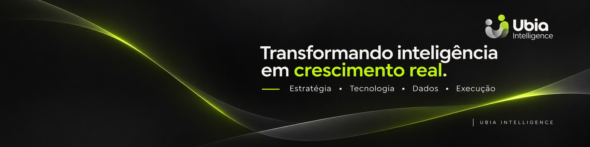
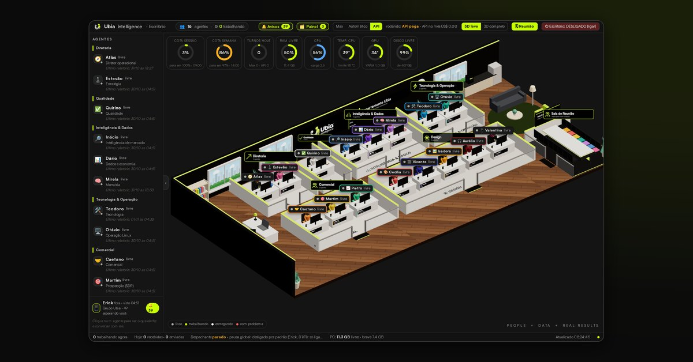
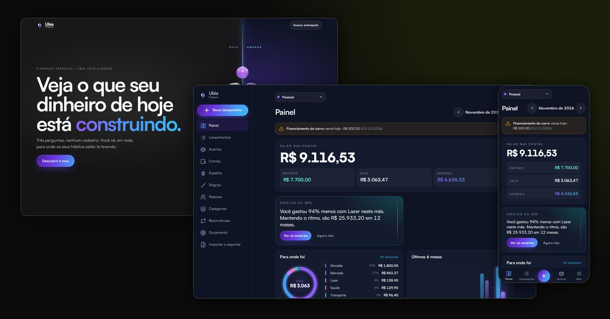
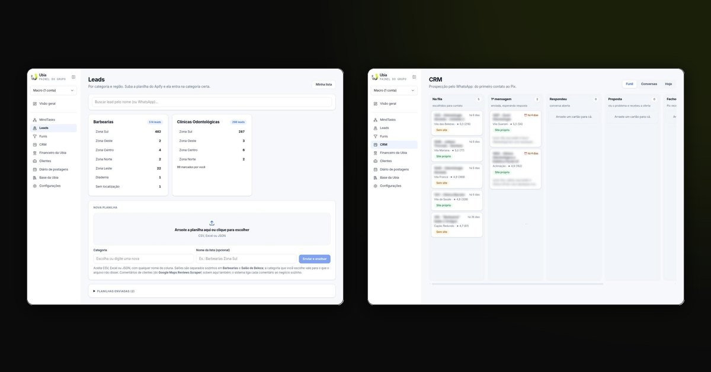
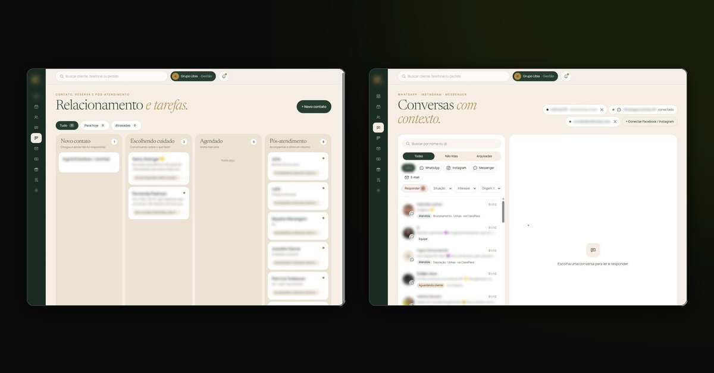
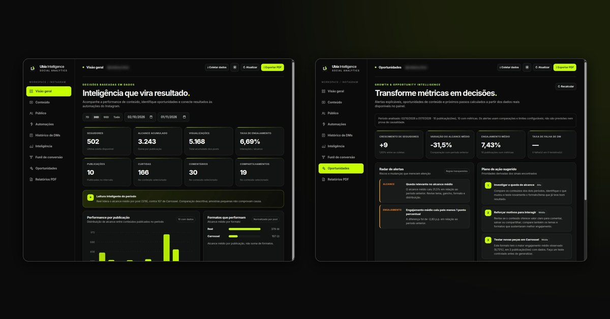

  

<h1 align="center">Erick Wendel</h1>

  <b>Founder da <a href="https://grupoubia.com.br">Ubia Intelligence</a></b> 
  Inteligência de mercado, sistemas e IA para negócios crescerem com fundamento.

  
  
  

---

### Como eu trabalho

Toda empresa perde dinheiro em algum ponto que ninguém está olhando. Meu trabalho começa aí:

1. **Enxergar de fora:** cruzo dados públicos (Google, avaliações, Receita Federal, IBGE) para ver como o negócio aparece para o mercado.
2. **Entrar na empresa:** leio a operação e os números de cada etapa para achar as lacunas, o faturamento possível que ainda não acontece.
3. **Construir o que falta:** sistemas, CRM, automações, agentes de IA, sites e marketing ligado à venda. Tudo sob medida.

### O que estou construindo

<table>
  <tr>
    <td width="50%" valign="top">
       
      <b>Operação com agentes de IA</b> 
      16 agentes organizados por departamento tocam a rotina interna da Ubia, com aprovação humana no que importa.
    </td>
    <td width="50%" valign="top">
       
      <b>Ubia Finance</b> 
      Finanças pessoais e da empresa no navegador: orçamento, dívidas com juros, cartão e o que o gasto de hoje teria virado no CDI.
    </td>
  </tr>
  <tr>
    <td width="50%" valign="top">
       
      <b>Hub Ubia</b> 
      Prospecção com dados públicos e CRM pelo WhatsApp: cada lead chega com evidência do problema antes do primeiro contato.
    </td>
    <td width="50%" valign="top">
       
      <b>Ecossistema para estética e bem-estar</b> 
      Site com agendamento, agenda unificada, funil de relacionamento, conversas de WhatsApp, Instagram e Messenger num lugar só e agentes de IA no atendimento.
    </td>
  </tr>
  <tr>
    <td colspan="2" valign="top">
       
      <b>Ubia Social Analytics</b> 
      Hub de Instagram construído sobre o IG Automations (open source): DM automática por palavra-chave com rastreio de entrega, métricas diárias, alertas e plano de ação a partir dos números do perfil.
    </td>
  </tr>
</table>

Prints reais dos sistemas. Nomes de clientes desfocados.

### Ferramentas do dia a dia

  
  
  
  
  
  
  
  
  
  
  
  

---

<b>Enxergamos antes. Crescemos juntos.</b>

